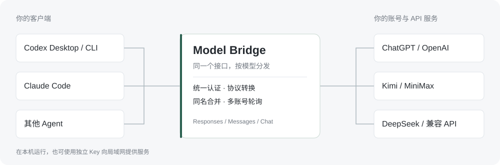

# Model Bridge

**把多个模型账号接到同一个本地接口，在 Codex、Claude Code 和其他 Agent 中使用。**

支持 ChatGPT、Kimi、MiniMax、DeepSeek、Anthropic 与兼容 API。客户端接入一次，由网关处理认证、协议转换和模型分发；也可以随时切回客户端原来的认证。

[下载安装](#下载安装) · [开始使用](#开始使用) · [功能](#功能) · [使用文档](docs/guide.md) · [更新记录](https://github.com/OrenZhang/model-bridge/releases)



## 下载安装

当前为 **`0.1.0-alpha.2`** 开发预览。安装包与更新文件统一发布到 [GitHub Releases](https://github.com/OrenZhang/model-bridge/releases)。桌面应用自带运行时，无需安装 Node.js 或 Codex CLI。

| 系统 | 架构 | 安装包 |
| --- | --- | --- |
| macOS | Apple Silicon | [DMG](https://github.com/OrenZhang/model-bridge/releases/download/v0.1.0-alpha.2/Model-Bridge-0.1.0-alpha.2-mac-arm64.dmg) |
| macOS | Intel | [DMG](https://github.com/OrenZhang/model-bridge/releases/download/v0.1.0-alpha.2/Model-Bridge-0.1.0-alpha.2-mac-x64.dmg) |
| Windows | x64 | [安装程序](https://github.com/OrenZhang/model-bridge/releases/download/v0.1.0-alpha.2/Model-Bridge-0.1.0-alpha.2-win-x64.exe) |
| Linux | x64 | [AppImage](https://github.com/OrenZhang/model-bridge/releases/download/v0.1.0-alpha.2/Model-Bridge-0.1.0-alpha.2-linux-x64.AppImage) · [Debian / Ubuntu](https://github.com/OrenZhang/model-bridge/releases/download/v0.1.0-alpha.2/Model-Bridge-0.1.0-alpha.2-linux-amd64.deb) |
| Linux | ARM64 | [AppImage](https://github.com/OrenZhang/model-bridge/releases/download/v0.1.0-alpha.2/Model-Bridge-0.1.0-alpha.2-linux-arm64.AppImage) · [Debian / Ubuntu](https://github.com/OrenZhang/model-bridge/releases/download/v0.1.0-alpha.2/Model-Bridge-0.1.0-alpha.2-linux-arm64.deb) |

macOS：打开 DMG，将应用拖入“应用程序”。当前安装包尚未签名、公证；是否允许运行由系统安全设置决定。Linux 桌面需可用的系统凭据库，安装说明见 [Linux 文档](docs/linux.md)。

**更新**：点击客户端左下角的版本号，检查新版本、查看说明并下载。下载完成后再安装，应用不会静默安装。Windows 和 Linux 通过对应平台的更新器安装并重启；macOS 下载并校验 DMG，打开后退出应用、拖入“应用程序”替换。账号、密钥和设置保存在独立数据目录。详见 [发布与更新](docs/updates.md)。

## 开始使用

1. **添加连接**：在“连接”中登录账号、复用本机 Codex 登录，或填写 API Key。连接后自动获取模型；服务商没有模型列表时，可使用预置目录或手动填写。
2. **选择模型**：在“模型”页查看聚合目录。默认全部启用，取消勾选的模型不会对外提供。同名模型合并，只显示原始模型名。
3. **接入客户端**：在“客户端”选择 Codex 或 Claude Code，启用“统一模型”。应用备份并写入本机配置；随后在客户端选择模型。切换后，已打开的客户端可能需要重启。

需要使用原来的账号时，在“客户端”切回“原始认证”。切换保留原有登录文件，也保留后来修改的不相关设置。

### 分享给局域网中的其他设备

在“对外服务”启用局域网访问，创建独立 Key，选择实际网卡地址并复制接入配置。可复制 macOS / Windows / Linux 执行脚本、原生配置，或导出 ZIP。配置脚本需要接收端安装 Node.js 18+，执行前会备份已有配置。

每个 Key 单独统计用量，也可以改名、停用。网关所在电脑需要保持运行。`0.0.0.0` 用于监听，接收端应填写网卡 IP，例如 `http://10.11.40.80:18765`。

## 功能

| 能力 | 可以做什么 |
| --- | --- |
| 账号与 API Key | ChatGPT 官方浏览器登录、设备码登录、本机 Codex 账号复用；Kimi / MiniMax 订阅授权与 API Key；多个账号独立保存 |
| 三种协议 | 提供 Responses、Messages、Chat Completions；请求进入同一网关后按模型路由，再适配目标连接 |
| 多轮与工具调用 | 转换文本、工具调用与结果、流式事件和 thinking 历史；后续消息回到原通道 |
| 同模型分发 | 相同原始模型 ID 跨账号、API Key、订阅通道合并，新对话在可用通道间轮询；已有对话保持账号归属 |
| 推理模式 | 在连接中按模型设置 GPT 的推理等级，以及 Kimi、MiniMax、DeepSeek 等模型支持的模式；可跟随客户端或固定模式 |
| 模型管理 | 自动发现、手动添加、同步目录；按模型控制是否对外提供，隐藏模型的直接调用也会被拒绝 |
| 客户端切换 | Codex 桌面端 / CLI、Claude Code 在统一模型与原始认证之间切换；配置写入前备份 |
| 局域网服务 | 本机或局域网监听、独立访问 Key、分 Key 用量、跨平台配置脚本 |
| 连接代理 | 按连接使用系统网络、直连、HTTP / HTTPS / SOCKS5，或 Clash / Mihomo YAML 订阅；不修改系统代理 |
| 用量统计 | 请求数、成功率、输入 / 输出 / 缓存 Token、延迟与估算费用，支持筛选和 CSV；只保留最近 60 天，过期自动删除 |
| 版本更新 | 从 GitHub Releases 检查版本，显示下载进度，校验安装包，提供对应平台的安装入口 |

同模型分发以**新对话**为单位，不是每条消息换账号。后续消息、thinking 与工具结果保持原通道；原账号失效时明确报错。新的对话会暂时避开已知过期、无权限或限流的通道，不自动重发模型请求。

## 统一接口

默认监听 `http://127.0.0.1:18765`。三种协议共用模型目录和分发逻辑，接口要求网关访问 Key。

| 协议 | 客户端 Base URL | 请求路径 |
| --- | --- | --- |
| Responses | `http://127.0.0.1:18765/v1` | `/v1/responses` |
| Messages | `http://127.0.0.1:18765` | `/v1/messages` |
| Chat Completions | `http://127.0.0.1:18765/v1` | `/v1/chat/completions` |

`GET /v1/models` 返回已启用的模型。Codex 使用生成的专用模型目录。局域网接入时，将 `127.0.0.1` 替换为网关机器的实际 IP。

## 数据保存在本机

| 系统 | 默认数据目录 |
| --- | --- |
| macOS | `~/Library/Application Support/Model Bridge/` |
| Windows | `%APPDATA%\Model Bridge\` |
| Linux | `$XDG_CONFIG_HOME/Model Bridge/`，默认 `~/.config/Model Bridge/` |

调用元数据放在 `usage/`，按 UTC 日期每天一个 `.jsonl` 文件，只保留含当天的最近 60 个 UTC 日，不记录提示词或回复正文。桌面密钥通过系统凭据服务加密；本机 Codex 登录副本使用私有文件权限保存。详见 [存储说明](docs/guide.md#数据存储)。

可通过 `MODEL_BRIDGE_DATA_DIR` 指定数据目录。关闭窗口后网关留在托盘，选择“退出”才会停止。

## 开发

需要 Node.js **22.19+**，仓库使用 `22.22.2`。

```sh
git clone https://github.com/OrenZhang/model-bridge.git
cd model-bridge
npm ci
npm run desktop
```

```sh
npm run check
npm test -- --maxWorkers=2
npm run build
npm run package
```

无界面模式、环境变量和配置示例见 [使用文档](docs/guide.md#无界面网关)。发布新版本时，版本号与 Git 标签保持一致；推送 `v*` 标签后，Release 工作流构建各平台安装包并发布更新文件。

## 兼容范围与文档

当前为 Alpha。三种协议的文本、流式、多轮、工具调用和 thinking 已有测试；真实 Kimi / MiniMax 调用结果与模拟上游结果分别记录。跨协议暂不支持 `previous_response_id`、托管会话、音视频、服务端工具等高级能力。套餐剩余额度和官方账单尚未接入，本机统计只覆盖本网关的请求。

| 文档 | 内容 |
| --- | --- |
| [使用与兼容性](docs/guide.md) | 登录、分发、代理、配置与完整限制 |
| [发布与更新](docs/updates.md) | 更新行为、安装方式、Release 流程 |
| [订阅认证](docs/provider-auth.md) | Kimi / MiniMax 授权与套餐边界 |
| [连接与服务控制](docs/connection-controls.md) | 推理模式、独立 Key、CoSail 设备标识 |
| [验证记录](docs/validation.md) | 真实服务、Codex 与模拟测试的范围 |
| [局域网调用矩阵](docs/validation-lan-model-matrix.md) | 三协议、流式、多轮与工具调用结果 |
| [Linux](docs/linux.md) | AppImage、Debian 包与桌面凭据库 |

项目独立实现，参考同舟的交互设计。
