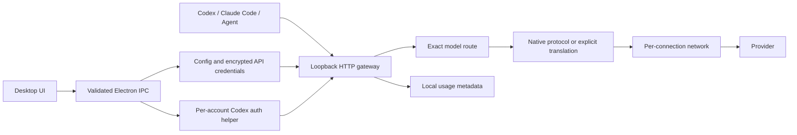

# 架构

## 分层

- `core/`：配置、模型目录、网络、持久化与用量；不依赖 UI。
- `auth/`：官方 Codex app-server 设备码流程。每个账号拥有独立 `CODEX_HOME`，不修改用户现有登录。
- `gateway/`：认证、路由、流式观察与协议转换。原生协议可用时优先透传；否则转换到明确的上游协议。
- `clients/`：配置计划、旧文件散列校验、备份与冲突恢复。
- `desktop/`：进程生命周期、系统凭据加密、系统代理解析、IPC。
- `ui/`：中文工作台，真实空状态，连接/模型/客户端/统计；网络为连接内可选项。
- `network/`：订阅节点解析、官方 mihomo 内核校验、受管进程和断开父进程后的回收。原始订阅全局配置不进入运行时，只重建节点、指定节点规则及本机认证端口。

## 关键决策

### 统一接口与账号网络是两层

本机网关始终存在。账号网络选择只控制网关到服务商的链路，不替代或开关统一模型路由。明确代理不可用时返回错误；不偷偷直连，也不重试到其他模型。

### 模型目录要适配客户端

OpenAI 模型列表不足以驱动 Codex 的模型选择器。生成完整 Codex catalog，并通过 `model_catalog_json` 接入兼容的本机版本，同时提供 `/codex/models` 给支持远程目录的版本使用。模型能力是配置数据；支持工具调用的模型才进入 Codex 目录。

### 流式转换必须保持语义

请求归一为系统文本、消息、图片、工具定义/调用/结果；返回统一文本、工具参数、用量及完成事件，再编码成客户端协议。保留工具 ID，支持 Codex namespace/custom tools 的基础映射。遇到无法表达的语义明确拒绝。

当前不转换 reasoning/thinking 状态，不允许通过丢弃它们来“假装成功”。这些状态是下一阶段的核心适配任务。原生接口字段由上游决定兼容性。

### 认证边界

客户端只持有本机访问密钥；上游凭据仅由主进程读取。ChatGPT 登录使用 bundled Codex `0.144.1` 的设备流程，刷新通过账号 RPC 发起。暂时读取受管理目录内的官方凭据缓存完成上游调用；该缓存尚未 OS 加密，属于明确的 Alpha 限制。

### 可恢复配置

配置预览时计算旧文件散列，应用时再次核对；恢复时只覆盖与当时写入结果相同的文件，否则保留用户后续修改并要求手工合并。原值被保留，TOML 注释和排版不保证保留。

### 账号复用、模型发现与局域网

本机检测只覆盖默认 Codex 目录和显式 `CODEX_HOME`，读取已知 auth 文件或直接系统 keyring 条目。展示数据不包含 token；用户点击复用后保存到账号的独立目录。原客户端配置与原凭据不被改写。复制授权的刷新冲突仍需真实账号回归。

配置保存和登录完成触发模型发现，按连接去重；失败保留已有目录。配置更新与目录写入排队执行，避免并发发现丢失其他连接。

局域网开关只改变模型网关监听地址，管理操作仍走本机 IPC。`0.0.0.0` 模式继续校验客户端密钥与浏览器 Origin，界面展示实际网卡地址。mihomo 内核不会因此向局域网开放。

### 统计

只保存请求元数据、服务商返回的用量和本地估算。流式结束前断开不算成功；没有 usage 时保持未知。图表和聚合覆盖所选时间内全部记录，明细限制最近 200 条。

## 一手参考

- [Codex 模型目录](https://learn.chatgpt.com/docs/model-catalogs)
- [Codex 登录](https://learn.chatgpt.com/docs/auth)
- [官方 Codex 源码](https://github.com/openai/codex)
- [MiniMax Anthropic 接口与 thinking 历史要求](https://platform.minimax.io/docs/api-reference/text-anthropic-api)
- [Electron safeStorage](https://www.electronjs.org/docs/latest/api/safe-storage)
- [Mihomo 官方版本与校验值](https://github.com/MetaCubeX/mihomo/releases/tag/v1.19.32)
- [Mihomo 网络配置](https://wiki.metacubex.one/en/config/general/)

协议与授权会变化；正式发版前应对锁定的客户端和服务商版本执行验收，而非仅依赖文档推断。
